# Stellwerk · a release cockpit where AI agents show their evidence

*Stellwerk* is German for the signal box of a railway: the room where one person sees every train on the line and sets the signals. I built it for release management.

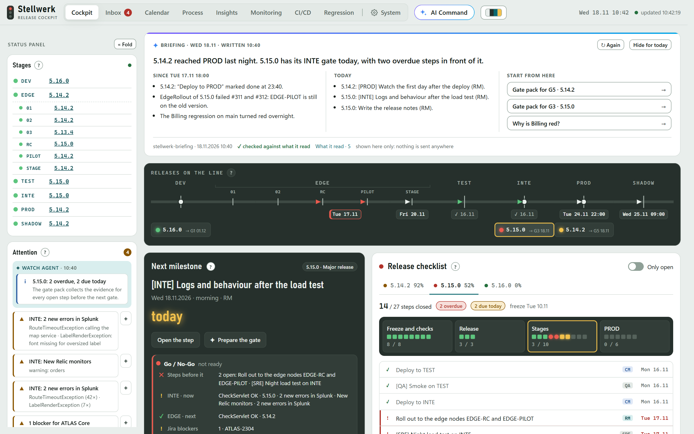

A big release is a long checklist spread over many tools. Jira has the tickets, Jenkins the builds, Confluence the release notes, ReportPortal the regression, Splunk and New Relic the evening after a deploy. The person who runs the release spends the morning opening tabs and asking "is this done?" in chats.

Stellwerk puts all of it on one screen. The checklist of the release (the playbook) is the center: every step has its day, its owner and the proof that it is done. Around it, Stellwerk reads the systems and shows where they disagree with the plan. A small team of AI agents does the reading and the first analysis, and every answer comes with the evidence it is based on. The decisions stay with the people.

> **About the screenshots.** They show a demo world: *Atlas Core*, a made-up parcel and freight platform with three releases in flight. Every outside system in them is a local stand-in with invented data, and the agents in the demo are scripted. The code of Stellwerk is private; this repository is its description.

## What it does

### The release line

Releases travel along the stages like trains: DEV, the edge nodes, TEST, INTE, PROD. The gates G1 to G5 are the signals between them. Each train stands where its closed steps took it, and a red date under a station means that step is overdue. Next to it: the next milestone with a Go / No-Go box that already knows what speaks against it (open steps, new errors, blockers), and the checklist itself.

The left panel reads the stages every few minutes and compares the version each one runs with the version the plan expects there. Alerts come from plain rules first. A watch agent may add its own on top.

### A morning briefing

Once a day, an agent reads everything that changed since the evening before and writes what the day asks for. In the screenshot above: the service pack went to PROD last night, the edge rollout of the major failed twice, a regression turned red, and two gates are due today. The briefing also offers the next clicks, here the two gate packs and the investigation of the red regression.

### "Why is this red?"

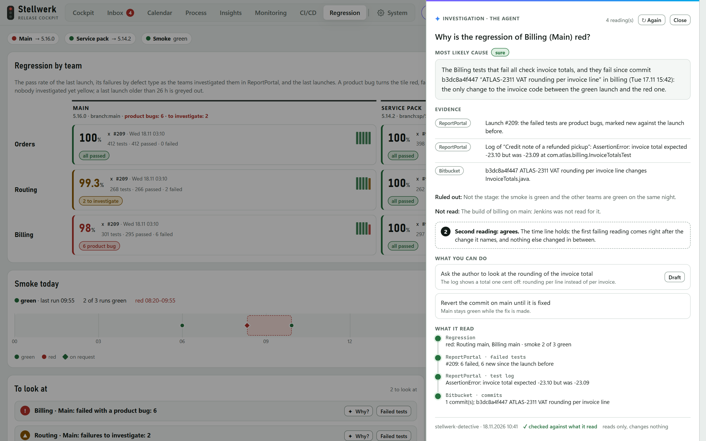

Every red tile has a *Why?* button. An investigating agent reads the systems with read-only tools: the failed tests, the error log of one of them, the commits between the last green run and the first red one. Its answer has a cause, the evidence for it, what it ruled out and what it did not read. A second agent then reads the same material as a skeptic and says whether it agrees.

Stellwerk checks every sentence of the answer against what the agents actually read. A sentence that names a version, a ticket, a date or a number that appears in none of the readings is dropped, and the page says so. An agent cannot invent a build number here.

### The gate pack

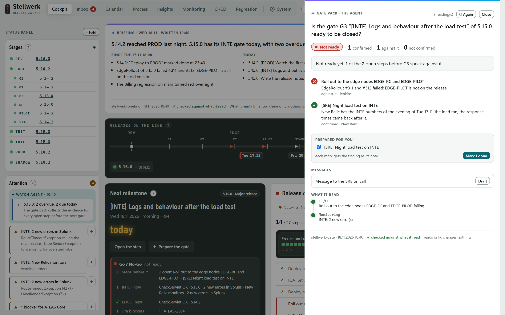

Before a gate closes, *Prepare the gate* collects the evidence for every open step before it. Each step gets a verdict: confirmed, against it, or not confirmed. A step with confirmed evidence can be ticked with one click, with the finding as its note. Here the night load test is confirmed by the monitoring, and the edge rollout speaks against the gate because Jenkins failed twice. The agent also drafts the message to the people who can fix it.

### Ask in your own words

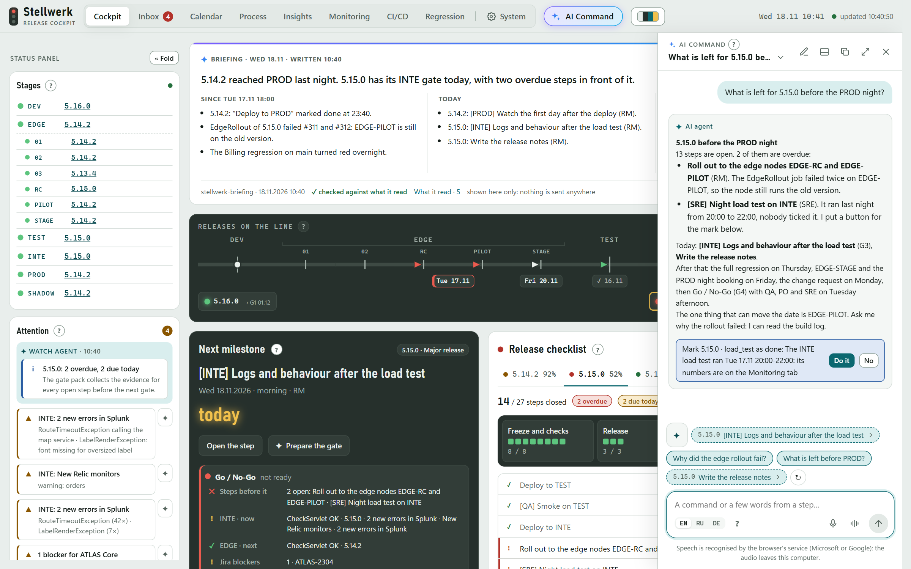

The AI Command window answers questions about the releases, by text or by voice. The agent may propose actions (mark a step, add a release, create the Jira tasks), and each proposal is a button. Nothing happens until someone presses it.

### What the release changes

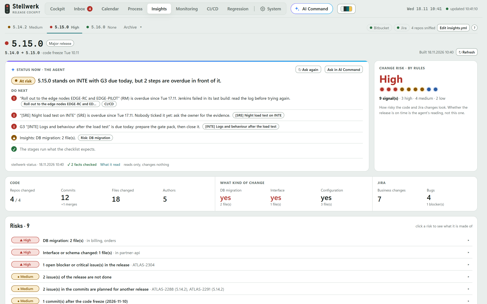

Insights reads the repositories and Jira for one release: which services changed, database migrations, interface changes, configuration, commits after the freeze, tickets that are not done. Rules turn that into risk signals. The status agent puts it next to the checklist and says what to do next, with links to the steps it means.

### The process as a picture

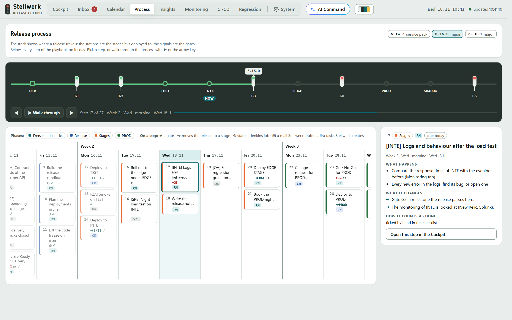

The playbook drawn as a track with its gates, and below it every step on its day. You can walk through the whole release step by step. It is drawn from the same playbook the checklist uses, so it is never out of date.

### And the rest of the day

| | |
|---|---|
| 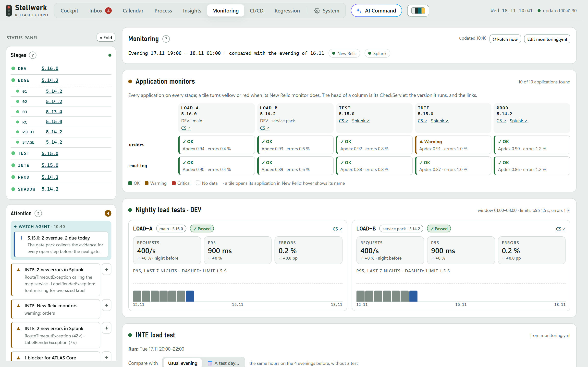 **Monitoring.** The evening after a deploy: every application on every stage, the load tests, new errors in the logs. | 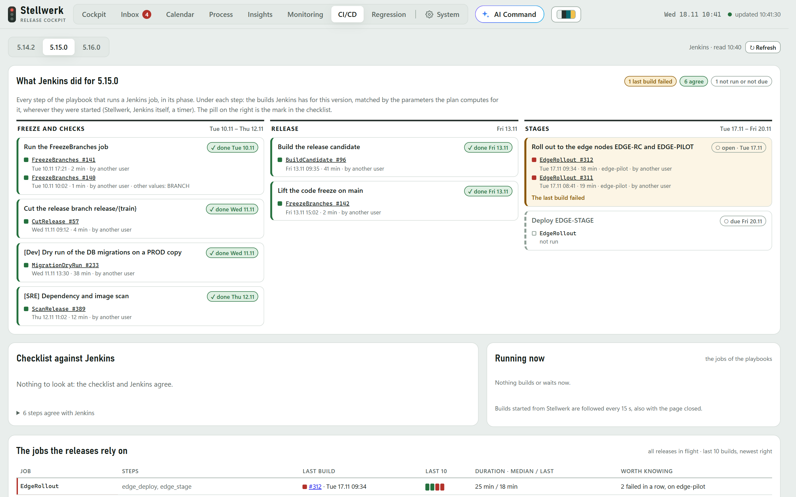 **CI/CD.** What Jenkins did for each step, held against the checklist. Jobs start from Stellwerk, always with a dry run first. |
| 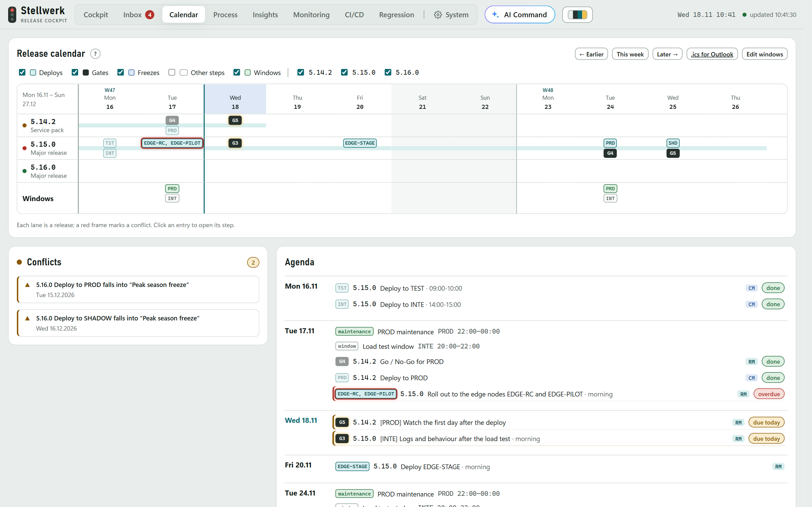 **Calendar.** Deploys, gates and maintenance windows of all releases, with the conflicts found for you (here: a PROD deploy inside a freeze period). | 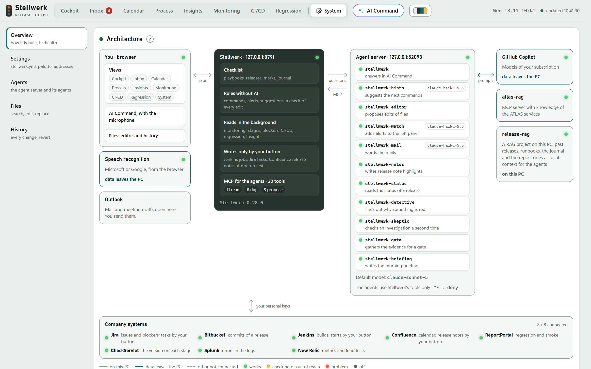 **System.** The architecture as it runs right now, drawn from the live settings: views, agents, tools, the local RAG and the connected systems. |

There is also a night palette for late deploys.

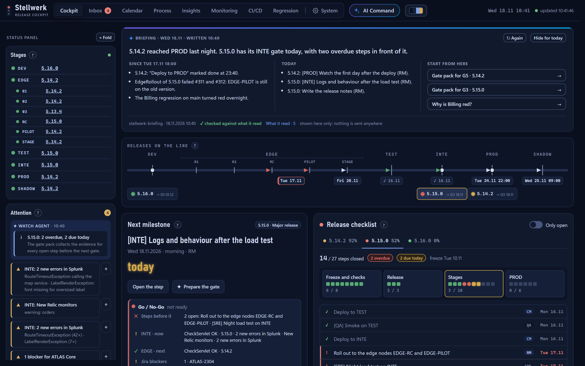

## How the agents are kept honest

This was the part I cared about most. An agent that sounds sure and is wrong costs more than no agent.

- **Agents read, people decide.** The agents only have read tools. Anything that writes (a Jenkins job, a Jira task, a release notes page, a mail) happens by a button of a person, and a dry run comes first.
- **Every claim is checked.** Versions, ticket keys, dates and numbers in an answer must appear in what the agent read. Otherwise the sentence is dropped, in plain sight.
- **A second reading.** Investigations are read again by a skeptic agent that only sees the readings and the conclusion.
- **Narrow roles.** Eleven small agents with one job each (status, briefing, investigation, gate pack, alerts, mail wording and so on) instead of one agent that can do everything. Each one is denied every tool it does not need.
- **Rules first.** Alerts, suggestions and risks work without any AI. The agents add to them; the cockpit does not depend on them.
- **The process is code.** Playbooks are YAML files with a history and a revert. A change to the process is a reviewed change, and the last step of every release is a short retro on the playbook itself.

## Why a Scrum Master builds a release cockpit

I come to this as a Scrum Master and release manager. Much of that role is about making work visible and helping a team decide on facts. In release work, the facts live in pipelines, logs and test reports, and many coordinators never open them.

Stellwerk is my way of closing that gap. The cockpit reads the technical signals and turns them into a picture everybody can use in a release meeting: what is done, what is proven, what speaks against the next gate. Status meetings get shorter because the evidence is already on the screen. And because every agent answer shows where it comes from, the team can trust it or check it, which is the same culture we ask for in code reviews.

## Architecture

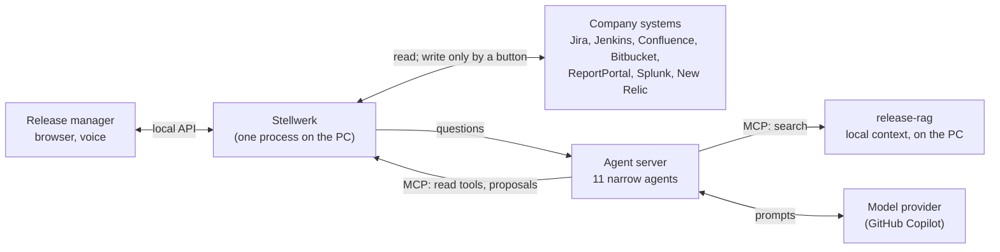

Stellwerk runs as a single process on the release manager's PC and serves the page locally. It reads the company systems with the user's personal keys and writes to them only on a button. The agents run on a local agent server and reach Stellwerk through MCP: 20 tools, of which 11 read what Stellwerk already knows (the checklists, the stages, the last readings), 6 read the systems directly for an investigation, and 3 make proposals that become buttons. The rules (alerts, suggestions, risks, the claim check) are plain code and run without any model.

The agents also have a memory of their own. A small RAG project on the same PC indexes past releases, runbooks, the journal and the repositories, and the agents search it through MCP. So an agent can look up how a similar problem went in an earlier release before it answers. The index stays on the PC.

More in the [architecture description](docs/architecture.md), written along arc42.

## Built with

Python 3.11 (standard library HTTP server, no web framework), Vue 3 with templates compiled ahead of time so the page runs under a strict Content Security Policy, YAML playbooks, a local agent server with MCP for the agents, a separate RAG project for their local context, packaged as one Windows executable. Quality checks: 685 automated tests, mutation checks for the important rules, and a walk through every view in a headless browser before each release.

## How I built it

I built Stellwerk in my own time, together with AI coding agents (Claude Code) as pair programmers. I set the direction, wrote the playbooks and the rules for how the agents may work, and reviewed every change; the coding agents wrote most of the code under those rules. Each version went through the full test suite, an architecture review along arc42 and a mutation check before it was released. Doing it this way taught me as much about leading AI agents as about release management.

## Status

A personal project, version 0.28. The demo world in the screenshots and everything in it is invented. Questions and feedback are welcome: [LinkedIn](https://www.linkedin.com/in/boris-levin-ai).
