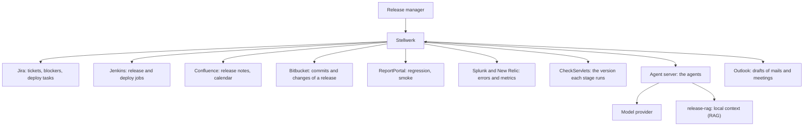
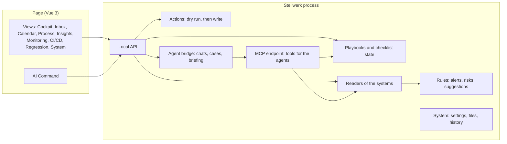
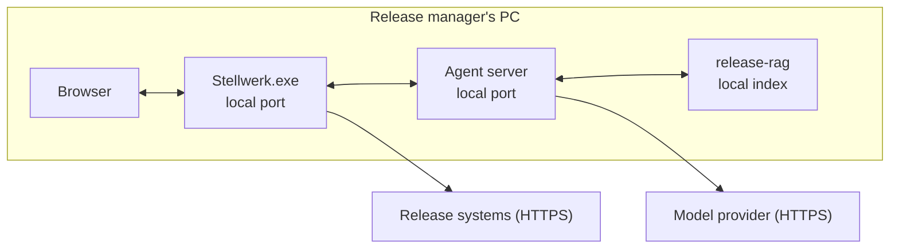

# Stellwerk · architecture

This description follows the twelve sections of [arc42](https://arc42.org), kept short. It describes what the system is made of and why, not every file. The examples come from the demo world of the screenshots (Atlas Core, a made-up platform).

## 1. Introduction and goals

Stellwerk is a release cockpit for one release manager. It keeps the release checklists (playbooks), reads the systems the release depends on, shows where they disagree with the plan, and lets a few narrow AI agents do the reading and the first analysis.

**Main tasks**

- Keep each release in flight on its playbook: every step with its day, owner and proof.
- Read the stages, the builds, the regression, the logs, the monitoring and the tickets, and compare them with the plan.
- Prepare decisions: the briefing of the day, the evidence for a gate, the cause of a red signal.
- Do the routine writes (Jenkins jobs, Jira tasks, release notes, mails) on a button, with a dry run first.

**Quality goals**

| Priority | Goal | What it means here |
|---|---|---|
| 1 | Trustworthy answers | An agent's statement either rests on something it read, or it is not shown. |
| 2 | Safe by default | Nothing is written to any system without a person pressing a button. |
| 3 | Useful without AI | The checklist, the rules and the alerts work when no model answers. |
| 4 | One screen, one glance | The state of every release is readable in a few seconds. |
| 5 | Easy to run | One executable on an office PC; no server, no database, no admin rights. |

**Stakeholders**: the release manager (main user), the teams and QA (owners of steps), product owner and SRE (sign-offs at the gates), whoever takes over the release role (playbooks as files they can read).

## 2. Constraints

- Runs on a Windows office PC as one process; the page is served locally and is reachable from this PC only.
- Uses the personal access keys of the user for each system it reads; keys stay in the Windows credential store or the environment of the process.
- Talks to the release systems only through their public REST APIs.
- The agents run on a local agent server and use the models the organisation's subscription allows.
- The page loads nothing from the internet and runs under a strict Content Security Policy.

## 3. Context and scope

The agents get their background from two places: Stellwerk's own tools, and *release-rag*, a separate RAG project on the same PC with past releases, runbooks, the journal and the repositories.

Stellwerk reads all of these systems. It writes only to Jenkins, Jira and Confluence, and only on a button. Mails and meetings are opened as drafts in Outlook; the user sends them.

## 4. Solution strategy

- **The playbook is the center.** A release is a playbook (major or service pack) plus a few dates. Every view, every rule and every agent works from the same steps.
- **Rules first, agents second.** Comparisons, alerts, risks and suggestions are plain code. Agents add analysis on top and never replace a rule.
- **Read tools and proposals.** Agents get tools that read; the only way for an agent to change something is a proposal that becomes a button.
- **Local memory apart from the cockpit.** Past releases, runbooks, the journal and the code are indexed by a separate RAG project on the same PC. The agents search it through MCP; Stellwerk itself stays small and needs no index.
- **Evidence before words.** Investigations, gate packs and briefings are "cases": every tool call is recorded, and the answer is checked against those recordings before it is shown.
- **Small and plain.** One process, the standard library of Python, files instead of a database, a page compiled ahead of time.

## 5. Building block view

| Block | Responsibility |
|---|---|
| Playbooks and checklist | Loads and validates the playbooks, computes the day and status of every step, keeps the marks, sign-offs and the journal. |
| Readers | One adapter per system. Each one reads, caches for a short time, and says clearly when it could not read. |
| Rules | Turns the readings into alerts, risk signals and suggestions, without any model. |
| Actions | Builds the exact request for a write (job parameters, Jira fields, page content), shows it as a dry run, sends it on the button, follows the result. |
| Agent bridge | Talks to the agent server: the chat of AI Command, the status of a release, the cases (investigations, gate packs, briefing) with their recorded readings and checks. |
| MCP endpoint | The tools the agents may call: read tools, investigation tools, proposal tools. |
| System | The settings, the files of the playbooks and agents with an editor, the history of every change with revert, the health of every connection. |
| Page | The views. Templates are compiled ahead of time; the page has no eval and loads nothing from outside. |

## 6. Runtime view

**The morning briefing**

1. At the configured time (or at the first moment after it when the PC is on), Stellwerk reads Jenkins, the regression, the monitoring, the stages and the blockers anew.
2. It opens a case for the briefing agent with what it already knows: what is due today, what is overdue, what was marked since the evening, and a list of things it can start with one click.
3. The agent reads through the tools; each call is recorded as a reading of the case.
4. Its answer is checked against the readings. Lines with an unbacked claim are left out; the one-click offers are kept only if Stellwerk made them.
5. The card appears on top of the Cockpit until it is hidden for the day.

**"Why is this red?"**

1. The user presses *Why?* on a red tile. Stellwerk opens a case with the question and what it knows about the tile.
2. The investigating agent reads: the failed tests, a test log, the commits since the last green run, the build log.
3. The answer (cause, evidence, ruled out, not read, options) is checked against the readings.
4. A skeptic agent gets only the readings and the conclusion, and says whether it agrees.
5. The page shows the result, the second reading and the list of readings.

**A write on a button**

1. The user presses *Start* on a step with a Jenkins job.
2. Stellwerk renders the parameters for this release and shows the request as a dry run.
3. Only when the user confirms the dry run, Stellwerk sends the request with the user's key, then follows the queue and the build.
4. The CI/CD view later matches the build to the step by its parameters, wherever it was started.

## 7. Deployment view

Everything runs on one PC. The data (playbooks, settings, checklist state, journal, cases) are files next to the executable, so a backup is a copy of a folder.

## 8. Crosscutting concepts

- **Safety of the local API.** Requests are accepted from this PC only; writes need a header a foreign web page cannot send; the MCP endpoint refuses browser requests.
- **Keys.** Personal keys per system, read from the credential store or the environment. A key a system refused is not sent again until it changes.
- **Claim check.** Versions, ticket keys, dates, times and larger numbers in an agent's text must appear in the readings of its case. The check is strict on purpose: a dropped sentence is shown as dropped.
- **Dry run.** Every write is first shown exactly as it would be sent.
- **Journal.** Every mark, sign-off, start and change of a file is written to a journal; the journal on the Cockpit and the history of each file read it.
- **Languages and look.** English and Russian on the page; several palettes, a night palette among them; the layout works down to a phone width.
- **Testing.** Unit and integration tests against local stand-ins of every system, mutation checks for the rules that matter most, and a scripted walk through all views in a headless browser.

## 9. Architecture decisions

| Decision | Why |
|---|---|
| Standard library HTTP server, no framework | Nothing to install on an office PC; a small attack surface; enough for one user. |
| Vue templates compiled ahead of time | The page runs under a strict Content Security Policy without eval. |
| Playbooks as YAML files | Readable by a person, reviewable as a change, easy to hand over. |
| An existing agent server and MCP instead of an own agent loop | Model access, sessions and permissions come from a maintained tool; Stellwerk only defines tools and checks answers. |
| Local context in a separate RAG project | The index can be rebuilt or replaced without touching the cockpit, other tools can use it too, and it never leaves the PC. |
| Many narrow agents instead of one | Each role gets the smallest set of tools and a short instruction; failures stay local. |
| Agents read, proposals become buttons | A wrong answer can mislead, but it cannot change a system. |
| Claim check against recorded readings | It catches invented numbers and keys, the most common and most expensive kind of error. |

## 10. Quality requirements

| Scenario | Expected |
|---|---|
| The model provider is down during a release night. | All views, rules and alerts keep working; the agent parts say they are unavailable. |
| An agent names a build number it never read. | The sentence is dropped and marked as dropped. |
| A Jenkins job is started by mistake. | It is not: the first press shows the dry run, only the confirmation sends. |
| A new person takes over the releases. | The playbooks, the journal and the Process view explain what happens when. |
| A system is not reachable (VPN off). | That part says it could not read; the rest of the cockpit stays usable. |

## 11. Risks and technical debt

- The claim check catches invented facts, not wrong reasoning on true facts. The second reading and the evidence list are there for that, and the person decides.
- Model limits and rate limits of the provider can slow the agents down on busy days.
- One PC means one place: a backup of the data folder is part of the routine.
- Playbooks drift from reality if nobody updates them. The retro step at the end of each release is the counter-measure.

## 12. Glossary

| Term | Meaning |
|---|---|
| Playbook | The list of steps of a kind of release (major, service pack), with phases, days and gates. |
| Step | One thing to do, with an owner, a day and the way it counts as done. |
| Gate | A milestone G1 to G5; some need Go / No-Go sign-offs. |
| Station | A stage a release is deployed to; a release stands at the furthest one its steps reached. |
| Case | An investigation, a gate pack or a briefing: an agent's work with its recorded readings. |
| Reading | One tool call of an agent in a case, with what it returned. |
| Proposal | An action an agent suggests; it becomes a button for the user. |
| RAG | Retrieval-augmented generation: the agents search an index of the team's own material (past releases, runbooks, code) before they answer. |
| Dry run | A write shown exactly as it would be sent, without sending it. |
